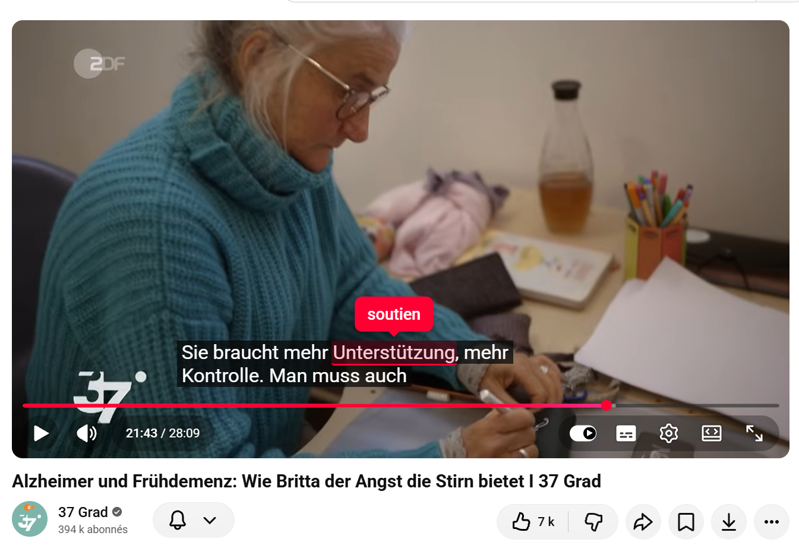
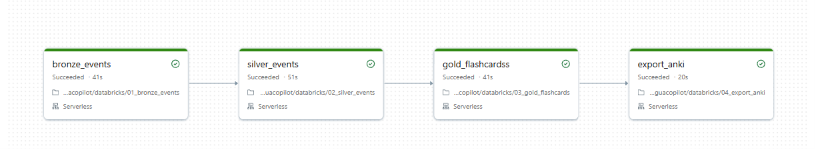
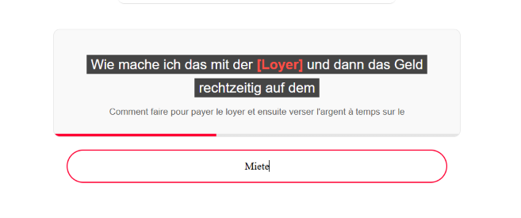
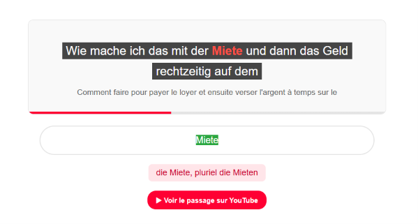
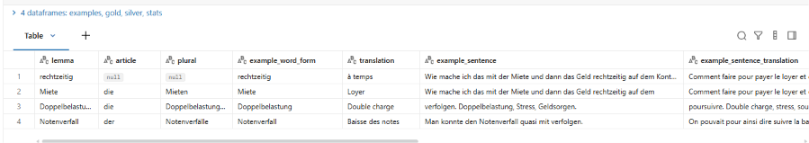
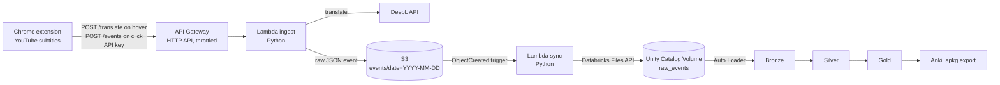

# LinguaCopilot

Hover a word in YouTube subtitles to see its translation, click it to save it, and find it the following week as an Anki flashcard built from the exact sentence where you heard it.

LinguaCopilot is an end-to-end data engineering project: a Chrome extension captures learning events, a serverless AWS backend ingests and enriches them, and a Databricks medallion pipeline turns them into a ready-to-import Anki deck.

## Demo

| Clicking a word on YouTube | Weekly Databricks job |
|---|---|
|  |  |

| Anki card, front | Anki card, back |
|---|---|
|  |  |

Gold table, one row per word to learn:



## Architecture



**Ingestion (real time, event driven).** Hovering a word for a short moment calls `POST /translate`, which returns the DeepL translation of the word (using the sentence as context) without storing anything, and the extension shows it in a bubble above the word. Clicking a word calls `POST /events` with the subtitle sentence, video id and timestamp. The ingest Lambda translates it, stores the enriched event as JSON in S3, and confirms the save to the extension. A second Lambda, triggered by each new S3 object, copies the file into a Databricks Volume.

**Transformation (weekly batch, incremental).** A Databricks Job chains four notebooks.

| Layer | Table | Content |
|---|---|---|
| Bronze | `bronze_events` | Raw events loaded incrementally with Auto Loader, plus source file and load time |
| Silver | `silver_events` | One row per click. Typed timestamps, test events removed, duplicates and double clicks removed, lemma added with `simplemma` |
| Gold | `gold_flashcards` | One row per word. Example taken from the most recent fully translated click, click count, first and last seen dates, article and plural for nouns (`german-nouns`), YouTube link to the exact moment |
| Export | `exports` volume | Anki package built with `genanki` |

## Tech stack

- **Extension**: JavaScript, Chrome Manifest V3 (content script and service worker)
- **AWS**: API Gateway (HTTP API), Lambda (Python 3.13), S3, IAM, CloudWatch
- **Databricks**: Unity Catalog Volumes, Auto Loader, Delta Lake, PySpark, Jobs, Git folders
- **Libraries**: DeepL API, simplemma, german-nouns, genanki

## Design decisions

**Push from AWS to Databricks instead of reading S3 directly.** Databricks Free Edition does not allow custom external locations, so Databricks cannot read the S3 bucket through Unity Catalog. The sync Lambda pushes each file into a managed Volume through the Databricks Files API instead.

**Separate routes for reading and saving.** Hover translation and click saving go through two routes of the same Lambda. Only clicked words reach the data pipeline, so the flashcards reflect deliberate choices rather than every word the mouse passed over. The extension waits 400 ms on a word before translating and caches translations in memory, which keeps DeepL usage low.

**Event-driven decoupling.** The ingest Lambda knows nothing about Databricks. If Databricks is unavailable, AWS retries the sync Lambda automatically and the raw event stays safe in S3, which remains the source of truth.

**Idempotent operations.** Files are uploaded with `overwrite=true`, so replaying the sync on the whole bucket (used once to backfill events) creates no duplicates. Silver deduplicates on `event_id`. Anki notes get a stable GUID derived from the lemma, so re-importing a new export updates existing cards and keeps the review history.

**`readStream` with `availableNow` rather than continuous streaming.** Auto Loader keeps track of already ingested files in its checkpoint, so each run only processes new files, then stops. This gives incremental processing at batch cost.

**Weekly schedule rather than a file arrival trigger.** A file arrival trigger would start a run for every click, while the flashcards are only reviewed once a week. Switching to near real time would only require changing the trigger.

**Graceful degradation.** If DeepL fails, the click is still saved without translation instead of being lost. Gold only keeps words with at least one fully translated click, and a word appears automatically once a translated click exists.

**Dictionary library rather than an LLM for grammar.** Article and plural come from Wiktionary data (`german-nouns`), which is free, deterministic and cannot hallucinate. Compounds missing from the dictionary take the gender of their last component, following German grammar.

**Least privilege.** Each Lambda role is limited to `s3:PutObject` or `s3:GetObject` on the project bucket only.

## Tests

Both Lambdas are unit tested with pytest, with AWS and HTTP calls mocked. The tests cover the API key check, the translate route not storing anything, the rejection of incomplete clicks, a click still being saved when DeepL fails, the decoding of S3 object keys, and the Databricks Files API URL and authentication header. They run on every push with GitHub Actions.

```
pip install boto3 pytest
pytest tests/aws -v
```

## Known limitations and next steps

- **Small files.** One JSON file per click is acceptable at this volume, and Delta compacts the data downstream. At scale, Amazon Data Firehose would batch events into larger files, possibly as Parquet.
- **Secrets.** The DeepL key, the Databricks token and the API key are Lambda environment variables. In production they would live in AWS Secrets Manager or SSM Parameter Store.
- **Authentication.** The API key protects a single-user setup but can be read from the extension code. A multi-user version would use per-user authentication, for example with Amazon Cognito.
- **Token scope.** The Databricks token uses the `all-apis` scope and could be restricted to file operations only.
- **Full refresh.** Silver and gold are rebuilt at each run, which is the simplest option at this volume. At scale they would be updated incrementally with `MERGE`.
- **Sentence boundaries.** The example sentence is the subtitle block displayed on screen, which is sometimes a fragment rather than a full sentence.
- **Infrastructure as code.** The AWS resources were created in the console. A next step is to define them with Terraform or AWS SAM.

## Repository structure

```
extension/                    Chrome extension
  manifest.json
  content.js                  Word capture, highlight, pause on hover, toast
  background.js               Calls the API
  config.example.js           Copy to config.js with your API URL and key
aws/
  lambda_ingest/              Translation with DeepL and write to S3
  lambda_sync_databricks/     Copy from S3 to the Databricks Volume
databricks/
  01_bronze_events            Auto Loader ingestion
  02_silver_events            Cleaning, deduplication, lemmatization
  03_gold_flashcards          One row per word, grammar enrichment
  04_export_anki              Anki package export
tests/aws/                    Unit tests for both Lambdas
.github/workflows/            CI running the tests on every push
```

## Setup

1. **AWS.** Create an S3 bucket, the two Lambdas with their environment variables (`BUCKET_NAME`, `DEEPL_API_KEY`, `API_KEY` for ingest, `DATABRICKS_HOST`, `DATABRICKS_TOKEN` for sync), an HTTP API with a `POST /events` route to the ingest Lambda, and an S3 trigger (prefix `events/`, suffix `.json`) on the sync Lambda.
2. **Databricks.** Create the schema `workspace.linguacopilot` and the volumes `raw_events`, `checkpoints` and `exports`, then a Job chaining the four notebooks.
3. **Extension.** Copy `extension/config.example.js` to `extension/config.js`, fill in your API URL and key, then load the `extension` folder in `chrome://extensions` with developer mode enabled.

## Version 1

The first version of LinguaCopilot was a batch Python NLP pipeline turning YouTube subtitles into CEFR-graded German flashcards, stored in SQLite. Its code is still available in `src/`.
